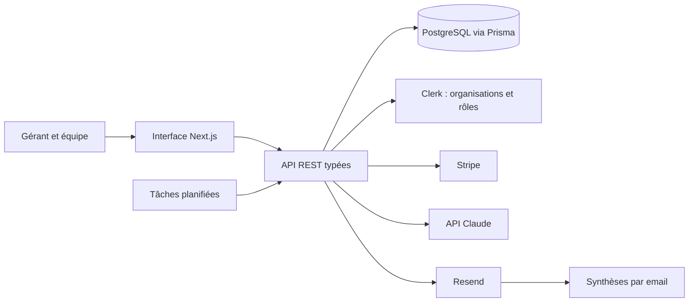

# Ynari : étude de cas

> SaaS de gestion opérationnelle pour restaurants et commerces alimentaires : stock, ventes, dépenses, paie et comptabilité. En production sur [ynari.fr](https://ynari.fr).

Conçu, développé et déployé seul, de bout en bout. Le code source est privé : ce dépôt présente le produit, l'architecture et les choix techniques.

## En chiffres

| | |
|---|---|
| Code | environ 30 000 lignes de TypeScript |
| Interface | une cinquantaine de pages |
| API | plus de 40 routes, typées de bout en bout |

## Le produit

Ynari regroupe dans un seul outil ce qu'un gérant suit d'habitude dans plusieurs tableurs : le stock, les recettes, les ventes, les dépenses, la paie et la comptabilité. Chaque semaine et chaque mois, le gérant reçoit par email une synthèse générée par IA : plats vedettes, recettes, dépenses.

## Stack

| Couche | Technologies |
|---|---|
| Front | Next.js 16 (App Router), React 19, TypeScript, Tailwind CSS, composants shadcn, Recharts |
| Back | Route Handlers Next.js, Prisma, PostgreSQL, Zod, React Hook Form |
| Auth | Clerk (multi-organisation, MFA), jetons signés (jose) |
| Paiements | Stripe |
| IA | API Anthropic Claude |
| Emails | Resend et React Email |
| Infra | Vercel, Upstash Redis |
| Qualité | Playwright, Sentry |

## Architecture

## Choix techniques

### Multi-tenant strict et permissions en cascade

Chaque commerce est une organisation isolée. Les droits se définissent en cascade : ce qu'un membre peut voir ou modifier dépend de son rôle dans l'organisation. L'authentification multi-organisation et la MFA reposent sur Clerk.

### API typées de bout en bout

Les schémas Zod valident les entrées côté serveur et alimentent les formulaires côté client, ce qui garde un seul contrat entre le front et le back sur plus de 40 routes.

### Synthèses générées par IA

Des tâches planifiées agrègent les données de la période, les envoient à l'API Claude, puis envoient au gérant un résumé hebdomadaire ou mensuel par email via Resend.

### Exports et tableaux de bord

Graphiques avec Recharts, exports PDF et CSV pour la comptabilité et le suivi.

### Sécurité et fiabilité

- Rate limiting avec Upstash Redis.
- Monitoring des erreurs avec Sentry.
- Tests E2E Playwright sur les parcours principaux.
- Revue de code et CI/CD avant chaque mise en production.

## Contact

Ayoub Lafdail · [lafdail.dev](https://lafdail.dev) · [LinkedIn](https://www.linkedin.com/in/lafdail)
